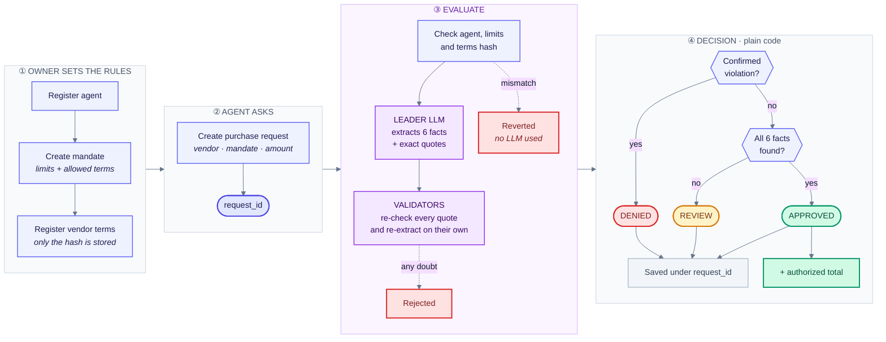

# MandateGate

A **GenLayer** Intelligent Contract that acts as a **semantic authorization ledger** for AI-agent purchases.

An owner defines a mandate (spending limits and contract-term limits). An agent asks for authorization to buy from a vendor. The contract reads the vendor's terms with an LLM, **only to extract six facts with verbatim quotes**, and plain code decides `APPROVED`, `DENIED` or `REVIEW`.

> **MandateGate does not move money.** There are no deposits, payments, escrow, withdrawals or PAID state. "Authorized total" is authorization accounting, not funds held and not proof of spending.

## Status

| Item | Value |
|---|---|
| Contract | `contracts/mandate_gate.py` (919 lines) |
| SDK / runner | Old generation: `# v0.2.16`, `py-genlayer:1jb45aa8ynh2a9c9xn3b7qqh8sm5q93hwfp7jqmwsfhh8jpz09h6` |
| Target network | **StudioNet** only. Not deployed to any network. |
| Tests | 399 Direct Mode tests (mocked LLM), all passing |
| Audit | **PASS WITH LIMITATIONS**: 0 critical, 0 high, 6 low, 4 informational. See [`docs/AUDIT_REPORT.md`](docs/AUDIT_REPORT.md) |
| Not verified | Loading in Studio, real multi-validator consensus with real LLMs, real rollback behavior |

## How it works



### The six facts

| # | Field | Type | Rule against the mandate |
|---|---|---|---|
| 1 | `automatic_renewal` | bool | `true` and the mandate disallows it → violation |
| 2 | `customer_data_training` | bool | same |
| 3 | `third_party_sharing` | bool | same |
| 4 | `minimum_commitment_days` | days | above the maximum → violation |
| 5 | `cancellation_notice_days` | days | same |
| 6 | `data_retention_days` | days | same |

Each field has a status: `FOUND`, `NOT_FOUND` or `AMBIGUOUS`. Missing is not false and not zero, and ambiguous never counts as compliant.

### Decision (computed by code, not by the LLM)

1. **DENIED** if there is at least one confirmed violation (even if other fields are missing).
2. **REVIEW** if there is no violation but some field is not `FOUND`.
3. **APPROVED** only if all six are `FOUND` and compliant.

### Terms commitment

`Keccak256( domain ‖ schema u32 ‖ length u64 ‖ UTF-8 bytes )`. It proves the text matches what the owner registered. It does **not** prove authorship, currency, completeness or legal validity. The text travels in calldata and is public (maximum 8192 bytes).

## API

**Owner:** `register_agent`, `revoke_agent`, `create_mandate_version`, `revoke_mandate_version`, `register_vendor`, `register_vendor_terms_version`, `revoke_vendor_version`, `revoke_authorization`.

**Agent:** `create_purchase_request`, `evaluate_purchase_request`. Owner or agent: `cancel_pending_request`.

**Views:** `compute_terms_commitment`, `get_request`, `get_mandate_version`, `get_vendor_version`, `get_budget_state`, `get_agent`.

Request states: `PENDING_EVALUATION` → `APPROVED` / `DENIED` / `REVIEW` / `CANCELLED`; `APPROVED` → `REVOKED`. Revoking does **not** reduce the historical total and does not undo external purchases.

## Try it in GenLayer Studio

All amounts are in **wei**. Suggested order (switch accounts between steps):

1. Owner: `register_agent(<agent address>)`
2. Owner: `create_mandate_version(2000000000000000000, 3000000000000000000, false, false, false, 365, 30, 30)`
3. Owner: `register_vendor("<terms text>")`
4. Agent: `create_purchase_request(1, 1, 1, 1000000000000000000, 0)` → returns `request_id`
5. Agent: `evaluate_purchase_request(<request_id>, "<exactly the same text>")`
6. Anyone: `get_request(<request_id>)` and `get_budget_state(1)`

If the text differs by a single character (space, line break, Unicode), the call fails before any LLM is used.

## Local development

```bash
pip install "genlayer-test @ git+https://github.com/genlayerlabs/genlayer-testing-suite@v0.29" \
            "genvm-linter @ git+https://github.com/genlayerlabs/genvm-linter@main"
export GENVM_VERSION=v0.2.16        # old-generation runner

genvm-lint check contracts/mandate_gate.py
pytest tests/direct -q
```

Versions used in the audit: genlayer-test 0.29.2, genvm-linter 0.11.0, pytest 9.2.0, Python 3.13.

| Test file | Tests | Covers |
|---|---|---|
| `test_smoke.py` | 1 | happy path |
| `test_registry_access.py` | 21 | registration, roles, revocations |
| `test_commitment_evidence_schema.py` | 107 | commitment, quotes, schema, Unicode |
| `test_decision_budget_atomicity.py` | 43 | decision (729 combinations), budget, atomicity |
| `test_consensus.py` | 178 | validator: each field, envelope, audit, replays |
| `test_injection_serialization.py` | 34 | prompt injection, serialization |
| `test_mutations.py` | 15 | the real contract survives; 14 weakened variants are caught |

Direct Mode runs only the leader path and replays the validator with mocks. **It does not prove real-network consensus.**

## Known limits

- Semantic relevance of quotes depends on the validator's LLM audit (finding L-01).
- A revoked request still shows `decision = APPROVED`; use `status` (L-02).
- Failures after the LLM call revert the transaction and leave the request pending, with no REVIEW record (L-03).
- A leader error cannot reach agreement: a liveness cost only (L-04).
- The suite does not cover post-consensus revalidation; the report proposes 9 tests (L-05).
- `APPROVED` is provisional until the GenLayer transaction is **Finalized** (L-06).
- `MAX_TERMS_BYTES = 8192` was not measured on a network.
- Prompt injection is a residual risk: mitigated, not eliminated.

Details, matrices and the remediation plan are in [`docs/AUDIT_REPORT.md`](docs/AUDIT_REPORT.md).

## Layout

```
contracts/mandate_gate.py       contract
tests/direct/                   Direct Mode tests (399)
docs/AUDIT_REPORT.md            independent audit report
pytest.ini, gltest.config.yaml  test configuration
```
